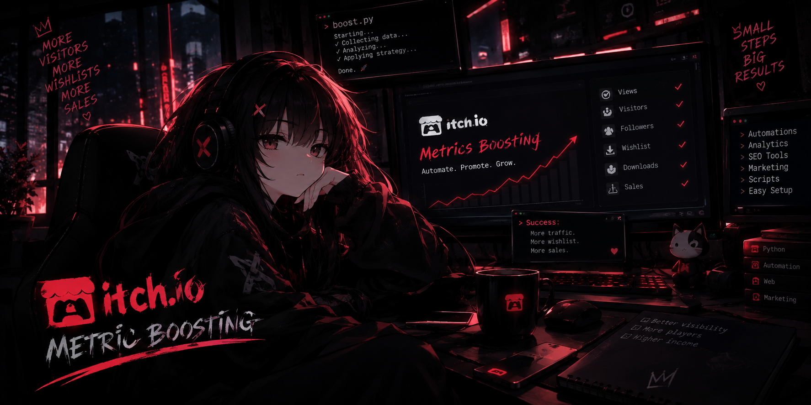

<p align="center">
  
</p>

<h1 align="center">D:ROCHILA — itch.io Metric Boosting</h1>

<p align="center">
  <strong>Cyber-grunge desktop automation interface built with Electron.</strong>
</p>

<p align="center">
  <code>Electron</code> · <code>Python</code> · <code>IPC</code> · <code>WebView</code> · <code>Real-time HUD</code>
</p>

---

## Overview

**D:ROCHILA V2** is a complete redesign of the original desktop application, rebuilt around a custom **Cyber-grunge / Opium** interface and a two-phase execution workflow.

The project combines a highly customized Electron interface, embedded browser environment, execution HUD, terminal-style event stream and Python backend integration into a single desktop application.

The focus of V2 is not simply adding more controls — it is building a **cohesive desktop product with a distinct visual system and clear separation between interface and execution logic.**

---

## V2 Architecture

The application is divided into two primary states.

### Phase 1 — Launch Interface

The initial screen acts as a dedicated launch console.

- Custom artwork-driven interface
- Large `DESTROY / THE PLANET` typography
- Monochrome treatment, grain and scanlines
- Decorative stars, orbital elements and Japanese-inspired UI details
- URL configuration
- Cycle configuration
- Speed controls
- Live status indicator
- `> STATUS: READY_TO_RUN`
- `START_PROTOCOL`

The interface is intentionally designed as a product experience rather than a conventional administration panel.

### Phase 2 — Execution Workspace

After starting the application, the interface transitions into the execution workspace.

- Embedded Electron `<webview>`
- Browser-style toolbar
- Back / forward / reload controls
- Direct URL loading
- Dedicated working area
- Live terminal-style event stream
- Execution HUD
- Launch count
- Requested cycles
- `TERMINATE` control
- Python backend communication through Electron IPC

The artwork is removed from the active workspace so the execution environment receives the full available screen area.

---

## Architecture

```text
D:ROCHILA V2
│
├── Electron
│   ├── Main Process
│   ├── Renderer
│   ├── IPC
│   └── WebView
│
├── Frontend
│   ├── Cyber-grunge UI
│   ├── Phase 1 — Launch
│   └── Phase 2 — Execution
│
└── Python Backend
    └── backend/
        └── bot_stub.py
```

Electron owns the desktop application and interface, while the Python layer provides a dedicated backend integration point through IPC.

This separation keeps the UI and backend responsibilities independent and makes the architecture ready for further backend development.

---

## Technology

- **Electron** — desktop runtime
- **JavaScript / HTML / CSS** — application interface
- **Python** — backend integration
- **Electron IPC** — frontend ↔ backend communication
- **WebView** — embedded browser workspace
- **Custom visual system** — Cyber-grunge / Opium design language

---

## Project Structure

```text
D:ROCHILA/
│
├── backend/
│   └── bot_stub.py
│
├── assets/
│   └── ...
│
├── docs/
│   └── banner.png
│
├── ...
│
├── package.json
├── START_WINDOWS.bat
└── ...
```

---

## Run

Install dependencies:

```bash
npm install
```

Start the development build:

```bash
npm run dev
```

### Windows

You can also launch the application through:

```text
START_WINDOWS.bat
```

---

## Backend Status

The current repository contains a safe backend integration layer:

```text
backend/bot_stub.py
```

At the moment, the backend **simulates execution events** and provides the integration point for the Electron application.

It does **not** perform real website automation.

This separation allows the desktop interface, IPC communication and execution workflow to be developed and tested independently from the final backend implementation.

---

## Project Status

**V2 — Active development**

The current version represents a substantial architectural and visual redesign of the original application.

The foundation is now built around a dedicated Electron desktop environment with separate launch and execution states, embedded browser functionality, real-time UI feedback and a Python backend integration layer.

Future development is focused on extending the backend while preserving the existing desktop architecture and visual system.

---

## Author

**Midoriaw**

Python Backend Developer

[GitHub](https://github.com/Midoriaw)